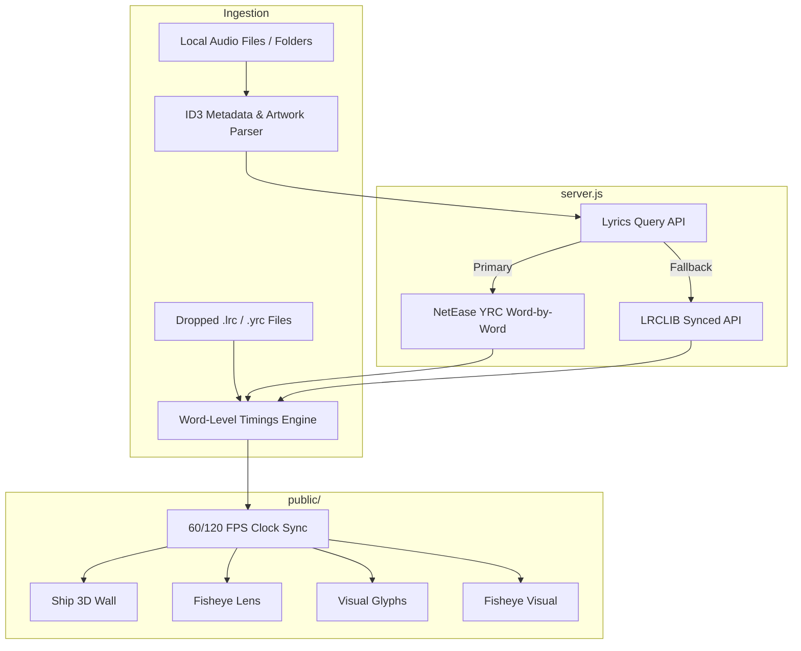

<div align="center">
  
  <h1>wavforms</h1>
  <p><strong>Real-time word-by-word synchronized lyrics on Windows.</strong></p>
  <p>Inspired by the minimalist luxury of Verci. Light lyrics one word at a time over pitch black glass.</p>

  <p>
    <a href="#features">Features</a> •
    <a href="#four-display-styles">The 4 Styles</a> •
    <a href="#quick-start">Quick Start</a> •
    <a href="#how-it-works">Architecture</a> •
    <a href="#license">License</a>
  </p>

  <p>
    
    
    
    
    
  </p>
</div>

---

## Overview

**wavforms** brings the acclaimed lock-screen word-by-word lyric experience from macOS (Verci) to Windows. 

Instead of scrolling a line at a time, **wavforms** reads real per-word timestamps (**YRC format**) and lights each individual word precisely as it is sung by the artist.

Upload your own music files or local folders, drag-and-drop `.lrc` / `.yrc` lyric files, or let the automated lyric engine fetch word-level timings instantly.

---

## ✨ Features

- **True Word-by-Word Timings**: Reads exact millisecond timestamps (`[start, duration](w_start, w_dur)Word`) powered by the NetEase Cloud Music YRC karaoke engine, with proportional word-length interpolation fallback via LRCLIB.
- **Pure Verci-Aesthetic Interface**: Pitch-black canvas (`#000000`), frosted glass top bar, minimal HUD scrubber, and massive typographic presence.
- **Drag & Drop Local Songs & Folders**: Drop any `.mp3`, `.wav`, `.flac`, `.m4a`, or `.ogg` files or entire folders. Built-in ID3 tag reader automatically extracts title, artist, album, and embedded cover art.
- **Custom Lyrics Support**: Drop custom `.lrc` or `.yrc` files directly into the window to synchronize your own lyrics.
- **Album Art Color Auto-Sync**: Dynamically samples the palette of your album art to calibrate the accent highlight glow.
- **Ambient Fullscreen Mode**: Press **`F`** to turn your monitor or TV into an ambient music centerpiece.
- **Keyboard Shortcuts**:
  - `Space`: Play / Pause
  - `←` / `→`: Seek ±5 seconds
  - `F`: Toggle Fullscreen

---

## 🎨 The 4 Display Styles

Switch styles seamlessly on the fly from the top menu bar:

| Style | Description |
| :--- | :--- |
| **Ship** | Words stack into a 3D perspective wall that subtly drifts with depth. |
| **Fisheye** | Convex spherical bulge lens effect — the active word sits closest to the glass with radial glare. |
| **Visual** | SF-style icons and emojis (`✨`, `💡`, `🌙`, `❤️`, `👀`, `👶`, `🔥`, `🏙️`) pop in beside sung words on their exact millisecond. |
| **Fisheye Visual** | The convex glass lens with icons active at the same time. |

---

## 🚀 Quick Start

### 1. Prerequisites
- **Node.js** (v18 or higher)
- Windows 10 or 11

### 2. Launching wavforms
Clone the repository and launch directly:

```bash
git clone https://github.com/wavforms/wavforms.git
cd wavforms

# 1-Click Launch (starts server & opens aesthetic desktop app window)
.\run.bat
```

Or via npm:
```bash
npm start
```
Then visit `http://localhost:3000` or let `run.bat` open it in a frameless desktop window.

---

## 🛠️ Architecture



---

## 📄 License

MIT License. See [LICENSE](LICENSE) for details.
