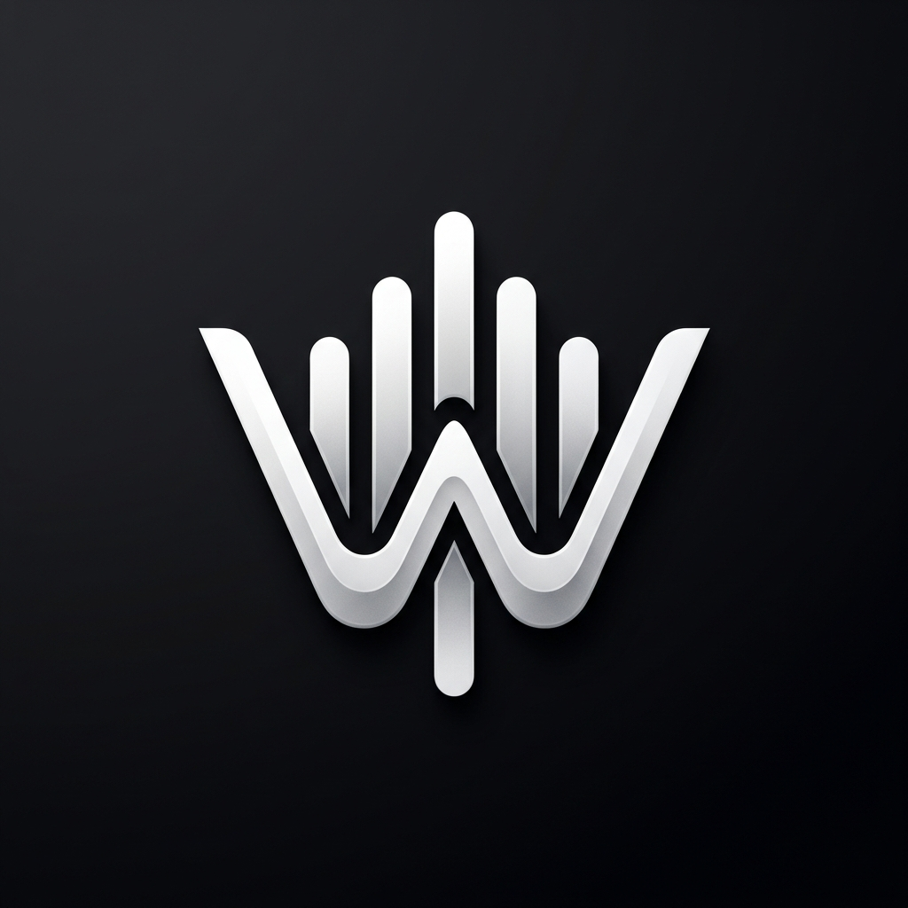
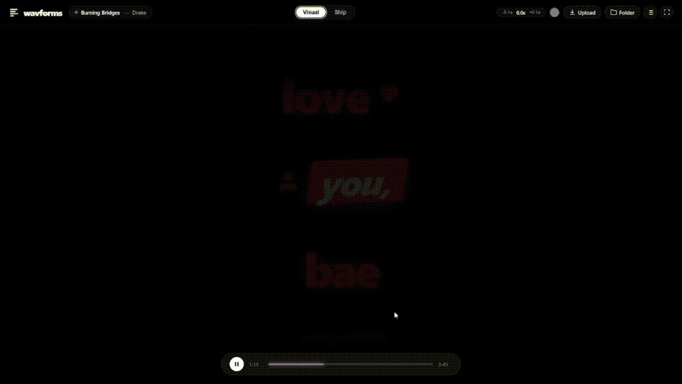

<div align="center">
  
  
  # wavforms
  
  <p><strong>Word-by-word real-time synchronized lyrics & MilkDrop 3 WebGL visualizer on Windows.</strong></p>
  <p>Inspired by the minimalist luxury of Verci. Lighting lyrics one word at a time over pitch-black glass & psychedelic audio reactive visuals.</p>

  <p>
    <a href="https://github.com/securitygeek15/wavforms/releases/latest">
      
    </a>
    <a href="https://github.com/securitygeek15/wavforms/releases/latest">
      
    </a>
  </p>

  <p>
    
    
    
    
    
    
  </p>

  <p align="center">
    <a href="https://github.com/securitygeek15/wavforms/releases/download/v1.0.0/wavformsshowcase.mp4">
      
    </a>
  </p>
</div>

---

## What is wavforms?

Most lyrics apps scroll an entire line of text at once. **wavforms** changes that.

It synchronizes to the singer at the **millisecond word level** (**YRC format**). Each word drops in like a water droplet and ignites with luminescent light and acoustic ripples the exact moment it is sung.

Combined with an integrated **MilkDrop 3 WebGL visualizer engine**, wavforms turns any music track into a hypnotic audio-reactive visual showcase powered by 367 classic and crazy visual presets.

No subscription, no account, no Spotify clutter. Just drop your songs in and experience your music.

---

## How It Works in 3 Steps

1. **Download & Run**: Grab the **[1-Click Windows Setup](https://github.com/securitygeek15/wavforms/releases/latest)** (or Portable ZIP). It sets up a desktop shortcut with the high-res icon.
2. **Drop Your Music**: Drag and drop any songs or your entire music folder (`.mp3`, `.wav`, `.flac`, `.m4a`, `.ogg`) into the window.
3. **Experience the Music**: `wavforms` automatically extracts the song's title, artist, and embedded cover art, matches the exact studio release, and lights the lyrics or audio visuals in real time.

---

## The 3 Display Modes

Switch styles anytime from the clean top navigation bar:

| Mode | Type | Experience |
| :--- | :--- | :--- |
| **Visual** | Kinetic Typography | **Velocity & Dynamic Accents** — Words light up with fast-paced velocity, paired with reactive lyric sentiment animations. |
| **Ship** | 3D Spatial Drift | **Perspective Wall** — Words stack onto a tilted spatial wall that drifts with gentle oceanic depth and camera parallax. |
| **Audio Visuals** | MilkDrop 3 WebGL | **Audio-Reactive Visualizer** — Pure full-screen MilkDrop 3 experience driven by live audio frequencies across 367 presets with 2.7s smooth crossfades. |

---

## MilkDrop 3 Visualizer Engine

Built directly on hardware-accelerated WebGL2 (Butterchurn), wavforms includes **367 curated presets** bundled completely offline from legendary demoscene and MilkDrop creators:

- **Featured Preset Creators**: Martin, Flexi, Ryan Geiss, Rovastar, Zylot, Unchained, Aderrasi, $$$ Royal, shifter, and more.
- **Preset Studio Drawer (`V`)**: Open the slide-out catalog to search, filter by author, or switch presets instantly.
- **Audio-Reactive Spectrum**: Fed directly from the audio playback pipeline with real-time waveform analysis.
- **Auto-Cycle Mode (`L`)**: Automatically crossfades to a new preset every 15 seconds for continuous hands-free visual journeys.
- **Random Jump (`R`)**: Instant crossfade to an unexpected visual preset.

---

## Discord Rich Presence (RPC)

`wavforms` natively broadcasts your current track and live lyrics directly to your Discord profile via local Windows IPC pipes:
- **Playing Status**: Displays your current song title, artist, and remaining elapsed time progress.
- **Real-Time Lyric Broadcast**: Displays the current lyric line in real time as the artist sings.
- **Zero Config**: Automatically connects to your desktop Discord client in the background.

---

## Shortcuts Cheat Sheet

| Key | Context | Action |
| :--- | :--- | :--- |
| `Space` | Any | **Play / Pause** (or cycle preset in visualizer) |
| `←` / `→` | Any | **Seek backward / forward 5s** |
| `F` | Any | **Toggle Fullscreen Mode** |
| `V` | Visualizer | **Open / Close Preset Studio Drawer** |
| `R` | Visualizer | **Random Preset Jump** (with smooth 2.7s crossfade) |
| `L` | Visualizer | **Toggle Auto-Cycle Mode** (15s rotation) |
| `[` / `]` | Visualizer | **Previous / Next Preset** |
| `[` / `]` | Lyrics | **Fine-tune Lyric Sync** (±100ms offset) |
| `Drag & Drop` | Any | **Import songs, music folder, or custom lyric files** |

---

## Development

```bash
git clone https://github.com/securitygeek15/wavforms.git
cd wavforms

# Quick launch
.\run.bat

# Or run via Node
npm start
```

---

## Frequently Asked Questions

<details>
<summary><strong>Where do the word-by-word lyrics come from?</strong></summary>
<br>
wavforms uses a dual-engine architecture:
1. <strong>NetEase Cloud Music YRC (Primary)</strong>: Reads true word-level karaoke timestamps (<code>[start, dur](w_start, w_dur)Word</code>) covering over 90% of popular music worldwide.
2. <strong>LRCLIB API (Fallback)</strong>: High-coverage synced lyric library paired with intelligent character-weighted proportional word interpolation.
</details>

<details>
<summary><strong>Can I use it offline with my own lyric files?</strong></summary>
<br>
Yes! Drop any <code>.lrc</code> or <code>.yrc</code> file alongside your songs (or onto an active song) and wavforms will immediately parse and synchronize it locally.
</details>

<details>
<summary><strong>Are MilkDrop 3 presets downloaded online?</strong></summary>
<br>
No. All 367 MilkDrop 3 presets and texture assets are bundled directly inside the local application, making the visualizer 100% offline-ready with zero latency.
</details>

<details>
<summary><strong>What audio formats are supported?</strong></summary>
<br>
All standard audio formats: <code>.mp3</code>, <code>.flac</code>, <code>.wav</code>, <code>.m4a</code>, <code>.ogg</code>, and <code>.aac</code>.
</details>

---

## License

Distributed under the **MIT License**. See [LICENSE](LICENSE) for details.
